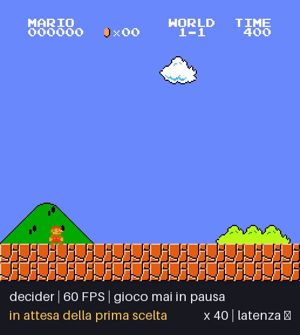
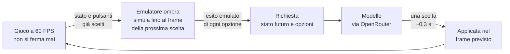

# SuperMAIrio

**Modelli di decisione rapida giocano a Super Mario Bros a velocità normale: il gioco non si ferma mai mentre il modello decide.**


<p align="center">
  
  <br>
  <sub>La vittoria più veloce registrata: livello 1-1 in 1465 frame, 24 secondi. La fascia in basso mostra la scelta del modello e la latenza della risposta.</sub>
</p>

SuperMAIrio usa Super Mario Bros come banco di prova per i **System One Model**,
modelli pensati per decisioni rapide: ricevono uno stato e una lista di opzioni e
rispondono con una sola opzione, senza spiegazioni.

La difficoltà è il tempo. Una risposta richiede circa 0,3 secondi, cioè 18 frame a
60 FPS: quando la scelta arriva, la situazione a cui rispondeva è già cambiata. In
questo modo i modelli **non hanno vinto nessuna delle 120 partite** del primo
benchmark. La soluzione è mostrare al modello non il presente ma l'istante in cui
la sua scelta avrà effetto, calcolato da un emulatore parallelo. Così gli stessi
modelli completano il livello.

## Risultati

Livello 1-1 a 60 FPS, con gioco mai in pausa e stesso identico contesto per tutti i
modelli: cambia solo l'identificativo nella richiesta. Ogni input è scelto dal
modello.

| Modello | Vittorie | Latenza mediana | Una scelta ogni | Costo medio a partita | Costo per vittoria |
| --- | ---: | ---: | ---: | ---: | ---: |
| **`decider`** (default) | **17/20** | 0,30 s | 42–49 frame | **0,0041 $** | 0,0048 $ |
| `d1` | 3/5 | 0,23 s | 40 frame | 0,0056 $ | 0,0093 $ |
| `gpt_luna` | 2/3 | 0,43 s | 60 frame | 0,0242 $ | 0,0363 $ |
| `jev` | 1/5 | 0,21 s | 36 frame | 0,0070 $ | 0,0350 $ |

Per `decider` il dato somma le due sessioni da 10 partite (8/10 e 9/10). Gli altri
modelli hanno meno partite: il confronto fra loro è indicativo. Metodo, sessioni e
limiti sono nel [benchmark del 30 ottobre](docs/benchmark-2026-10-30.md); i dati
grezzi sono in [docs/benchmark-data/](docs/benchmark-data/2026-10-30/).

| Configurazione | Risultato in 1-1 |
| --- | --- |
| **Modalità predittiva, 60 FPS** (default) | **Vince**: decider 17/20 |
| A turni, gioco fermo durante la decisione | Solo decider vince, sempre allo stesso modo |
| Tempo reale, 60 FPS, nessuna previsione | 0 vittorie in 120 partite ([benchmark del 29 ottobre](docs/benchmark-2026-10-29.md)) |

## Provalo

Servono [uv](https://docs.astral.sh/uv/getting-started/installation/) e una
[chiave OpenRouter](https://openrouter.ai/keys) con un minimo di credito. uv
scarica da solo Python 3.13 e le dipendenze; la ROM arriva con il pacchetto
`gym-super-mario-bros`.

```powershell
git clone https://github.com/alesacchii/SuperMAIrio.git
cd SuperMAIrio
copy .env.example .env    # su macOS e Linux: cp .env.example .env
# Scrivere la chiave in .env, alla voce OPENROUTER_API_KEY

uv run main.py
```

Si apre una finestra e `decider` gioca una partita di circa 30 secondi con la
configurazione migliore, già impostata. Il terminale riporta esito, costo e
cartella dei risultati.

```powershell
uv run main.py --episodes 10 --headless   # Benchmark: 10 partite, senza finestra
uv run main.py --model d1                 # Un altro modello: d1, gpt_luna, jev
uv run main.py --mode manual              # Giocare da tastiera, senza chiave
uv run main.py --mode demo                # Verificare i comandi, senza chiave
```

Tutti i comandi e le opzioni sono in [docs/cli.md](docs/cli.md). Il progetto è
stato provato su Windows 11; le dipendenze sono disponibili anche per macOS e
Linux, dove però non è stato provato.

## Quanto costa

**Una partita con la configurazione predefinita costa in media 0,004 $**: con 1 $ si
giocano circa 240 partite. Il dato viene da 20 partite di `decider` ed è la somma
di `usage.cost` riportata da OpenRouter divisa per il numero di partite, vinte o
perse. Comprende le due copie parallele di ogni richiesta. Le ultime 3 partite
giocate con la finestra sono costate in media 0,0045 $.

Una partita finisce con una vittoria, una vita persa o dopo 60 secondi, e una
sconfitta precoce costa meno di una vittoria. Le richieste annullate a fine partita
possono avere un costo non riportato e i prezzi dipendono dal provider: consideralo un
ordine di grandezza. Per vedere il costo reale di una sessione basta guardare il
terminale o `summary.json`.

## Come funziona



1. **Il gioco non aspetta.** Fra una scelta e l'altra Mario continua con i pulsanti
   già scelti. Quei pulsanti sono noti, quindi il futuro prossimo è calcolabile.
2. **Il modello vede il futuro.** Un emulatore ombra rigioca quegli input da uno
   snapshot, fino al frame in cui la prossima scelta sarà applicata. Lo stato inviato
   al modello, letto dalla RAM della NES, descrive quel frame.
3. **Ogni opzione mostra il suo esito.** Per le 10 scelte offerte l'emulatore
   simula che cosa succede e lo scrive nella descrizione, per esempio
   `Preview: Mario dies after 21 frames.` È un'informazione: il programma non
   sceglie e non scarta nulla.
4. **La risposta arriva in tempo.** Ogni richiesta viene inviata due volte e vale la
   prima risposta, che elimina gli stalli occasionali del provider. Il ritmo delle
   scelte è calcolato dalla latenza misurata.

Il programma non salta, non frena e non reagisce ai pericoli di sua iniziativa. La
spiegazione completa è in [docs/come-funziona.md](docs/come-funziona.md).

## Limiti

- **Conta la CPU locale.** Le anteprime emulano migliaia di frame al secondo. I
  risultati sopra sono stati ottenuti con 2300–2900 frame/s su un i5-1145G7 libero;
  a 1260–1310 frame/s decider è sceso a 4/10. Il programma misura la velocità
  all'avvio e avvisa sotto i 2000 frame/s. Dal benchmark in poi, comprese le sessioni
  con la CPU occupata, il totale è 25 vittorie su 48.
- **Il compito è più facile del tempo reale puro.** Grazie alle anteprime il modello
  non deve prevedere la fisica, ma scegliere fra esiti dichiarati.
- **Un livello, un seed.** Le prove riguardano solo 1-1. Prompt e catalogo delle
  scelte sono stati corretti osservando le morti in questo livello: non è una
  misura di generalizzazione ad altri livelli.
- **La latenza non è solo inferenza.** Comprende rete e servizio di OpenRouter.

## Struttura del progetto

```text
main.py                punto di ingresso
app/
  predictive.py        modalità predittiva: emulatore ombra, anteprime, ritmo delle scelte
  model_runner.py      ciclo modello in tempo reale e a turni
  game.py, scene.py    emulatore, snapshot e lettura della scena dalla RAM NES
  control.py, moves.py cataloghi delle scelte e mosse calibrate
  openrouter.py        client e worker delle richieste
  models/              un file per modello, scoperti automaticamente
docs/                  documentazione, benchmark e dati grezzi
scripts/replay_gif.py  rigioca una sessione registrata e crea una GIF
tests/                 suite senza chiamate a pagamento
```

| Documento | Contenuto |
| --- | --- |
| [Comandi e opzioni](docs/cli.md) | Avvio, tastiera, tutte le opzioni della riga di comando |
| [Come funziona](docs/come-funziona.md) | Che cosa riceve il modello, che cosa sceglie e quando |
| [Protocolli](docs/protocolli.md) | Specifiche di `buttons`, `timed`, `moves` e della modalità predittiva |
| [Risultati e metriche](docs/risultati-e-metriche.md) | Formato di `runs/` e definizione delle misure |
| [Aggiungere un modello](docs/aggiungere-un-modello.md) | Di solito bastano un file e un identificativo |
| [Sviluppo](docs/sviluppo.md) | Backend, interfaccia del gioco, test |
| [Storia del progetto](docs/storia.md) | Domanda di ricerca, cronologia, note sperimentali |

## Test

```powershell
uv run python -m unittest discover -s tests
```

La suite non richiede una chiave e non fa chiamate a pagamento. I test live e quelli
della finestra si attivano esplicitamente: vedere [docs/sviluppo.md](docs/sviluppo.md).

## Note legali

Il codice è distribuito con [licenza MIT](LICENSE). Progetto sperimentale non
affiliato a Nintendo. Super Mario Bros è un marchio di Nintendo. Il repository non
contiene ROM: quella usata proviene dal pacchetto
[`gym-super-mario-bros`](https://github.com/Kautenja/gym-super-mario-bros), i cui
termini sono nel relativo
[LICENSING.md](https://github.com/Kautenja/gym-super-mario-bros/blob/master/LICENSING.md).
