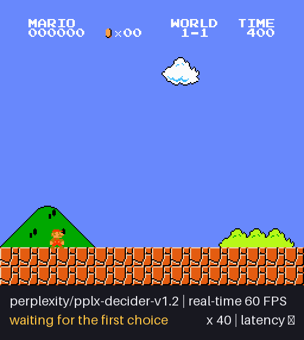
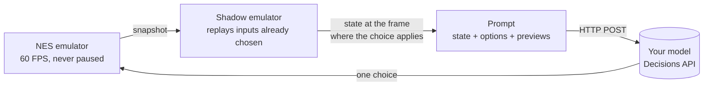
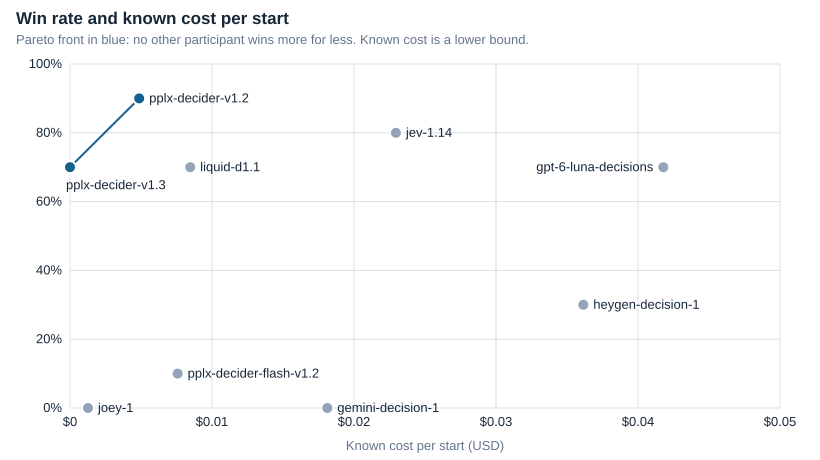

# SuperMAIrio

[](https://github.com/alesacchii/SuperMAIrio/actions/workflows/tests.yml)

[](LICENSE)

**A real-time benchmark for System 1 decision models, played on Super Mario Bros 1-1.**

<p align="center"></p>
<p align="center"><sub>Fastest win of the 2026-11-13 edition: <code>perplexity/pplx-decider-v1.2</code>, real-time track, 1,310 frames. Replayed from the logged inputs.</sub></p>

System 1 models answer in a single fast step: no chain of thought, one choice
from a list. SuperMAIrio measures how well they control a game that does not
wait for them. At 60 FPS a 300 ms answer costs 18 frames, so latency is as much
part of the score as the quality of the choice.

Any model behind an HTTP endpoint that speaks the small
[Decisions API](docs/decisions-api.md) can take part. Endpoint and model ID come
from the environment: there is no provider-specific code.

## The two tracks

| Track | What the model decides | When the choice applies | Limit |
| --- | --- | --- | --- |
| **Real-time** | One of 10 button inputs, held until its next choice | The game never pauses. A shadow emulator predicts the state at the frame where the choice will apply, and that is what the model sees | 3,600 frames or 60 s wall clock |
| **Turn-based** | Buttons, then how many frames to hold them (two questions) | The game waits for both answers | 3,600 frames |

Every participant gets the same instructions, the same state read from the NES
RAM and the same options. Only the model ID changes. Each model plays 10
finished games per track (at most 13 starts). The leaderboard
ranks wins with a 95% Wilson interval and reports latency, cost and
interruptions next to them. [Rules and scoring](docs/benchmark.md).



## Results: edition 2026-11-13

Nine models served by the [OpenRouter](https://openrouter.ai) Decisions API,
10 finished games per track. Full leaderboards, charts, every attempt and the
logs for offline replay: [results/2026-11-13](results/2026-11-13/README.md).
All 184 attempts pass `bench verify`.

**Real-time track**

| Rank | Model | Wins | 95% CI | Fastest win (frames) | Latency median / p95 s | Known $/start |
| ---: | --- | ---: | --- | ---: | --- | ---: |
| 1 | perplexity/pplx-decider-v1.2 | 9/10 | 60%–98% | 1,310 | 0.349 / 0.420 | 0.0049 |
| 2 | typesafe/jev-1.14 | 8/10 | 49%–94% | 1,796 | 0.217 / 0.267 | 0.0230 |
| 3 | openai/gpt-6-luna-decisions | 7/10 | 40%–89% | 2,353 | 0.204 / 0.342 | 0.0418 |
| 3 | liquid/d1.1 | 7/10 | 40%–89% | 1,751 | 0.289 / 0.475 | 0.0085 |
| 3 | perplexity/pplx-decider-v1.3:free | 7/10 | 40%–89% | 1,492 | 0.438 / 0.616 | 0.0000 |
| 6 | heygen/heygen-decision-1 | 3/10 | 11%–60% | 1,800 | 0.633 / 1.545 | 0.0362 |
| 7 | perplexity/pplx-decider-flash-v1.2 | 1/10 | 2%–40% | 2,648 | 0.207 / 0.241 | 0.0076 |
| 8 | google/gemini-decision-1 | 0/10 | 0%–28% | — | 0.228 / 0.373 | 0.0181 |
| 8 | baseten/joey-1 | 0/10 | 0%–28% | — | 0.235 / 0.255 | 0.0013 |



**Turn-based track:** only `perplexity/pplx-decider-v1.2` won a game (1/10,
2,386 frames); the other eight models won none.

How to read these numbers:

- Ten games per model give wide intervals: ranks 2–5 of the real-time track
  overlap.
- Latency is the whole HTTP request through OpenRouter, not inference time.
- Known cost is a lower bound. On the real-time track each decision sends two
  copies and the slower one is cancelled, so about half of the responses report
  no cost.
- Turn-based sessions ran four at a time; real-time sessions ran alone.

## Quickstart

Install [uv](https://docs.astral.sh/uv/getting-started/installation/), then:

```powershell
uv sync --locked
cp .env.example .env    # set SUPERMAIRIO_ENDPOINT, SUPERMAIRIO_MODEL, optional SUPERMAIRIO_API_KEY
```

**Benchmark**

```powershell
uv run supermairio bench run                       # print the schedule, no requests
uv run supermairio bench run --live                # collect the edition (may incur costs)
uv run supermairio bench report runs/benchmark-v1 --output results/v1
uv run supermairio bench verify results/v1/edition.zip
```

Participants are listed in [`benchmark.toml`](benchmark.toml): several models
on one endpoint, or one endpoint per model.

**Play**

```powershell
uv run supermairio play                            # the configured model, real-time track settings
uv run supermairio play --track turn-based         # exactly as in the turn-based track
uv run supermairio play --mode manual              # keyboard: arrows, Space, Shift
uv run supermairio play --mode demo                # scripted demo, no endpoint needed
```

The ROM comes with the `gym-super-mario-bros` dependency.

## Results

No edition has been published yet. A published edition includes its
leaderboard, every attempt as CSV, and an archive of the logs. Anyone can
replay that archive offline and check every reported position and outcome.

## Documentation

| | |
| --- | --- |
| [Benchmark](docs/benchmark.md) | Tracks, schedule, scoring, participants, collecting and publishing an edition |
| [Decisions API](docs/decisions-api.md) | The HTTP contract a model endpoint implements |
| [How it works](docs/how-it-works.md) | What the model receives and chooses, and the predictive loop |
| [Play](docs/play.md) | `supermairio play` options and keyboard controls |
| [Results format](docs/results-format.md) | Session logs in `runs/` and the definition of each metric |
| [Experimental modes](docs/experimental-modes.md) | Research protocols outside the benchmark |
| [Development](docs/development.md) | Code layout, tests and the dependency pins |

## Repository layout

```
supermairio/
  game/        emulator, RAM scene, button protocols, window
  agent/       Decisions client and the shared prompt
  runtime/     predictive and turn-based loops, session logs, metrics
  benchmark/   edition schedule, report, offline verification, GIF replays
  cli.py       the `supermairio` command
tests/         offline test suite (live and display checks are opt-in)
docs/          documentation
```

## License

MIT, see [LICENSE](LICENSE). SuperMAIrio is an independent research project
with no affiliation to Nintendo. Super Mario Bros is a trademark of Nintendo.
The ROM is provided by `gym-super-mario-bros` under
[its own terms](https://github.com/Kautenja/gym-super-mario-bros/blob/master/LICENSING.md).
