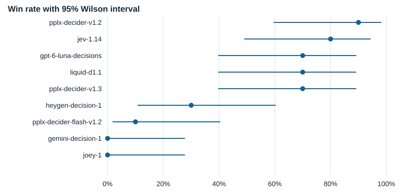
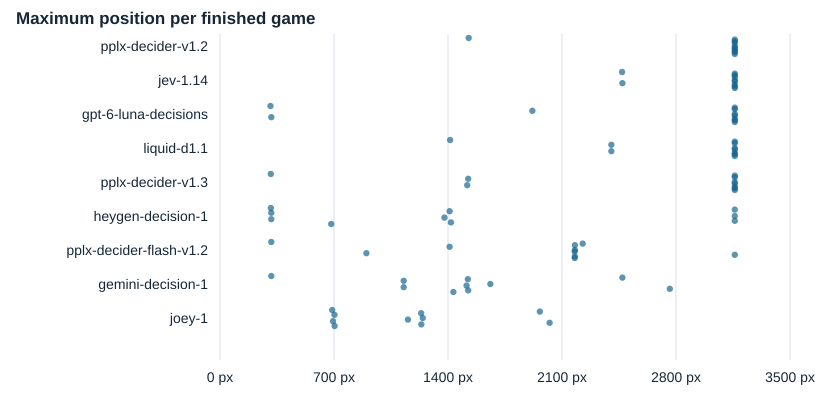
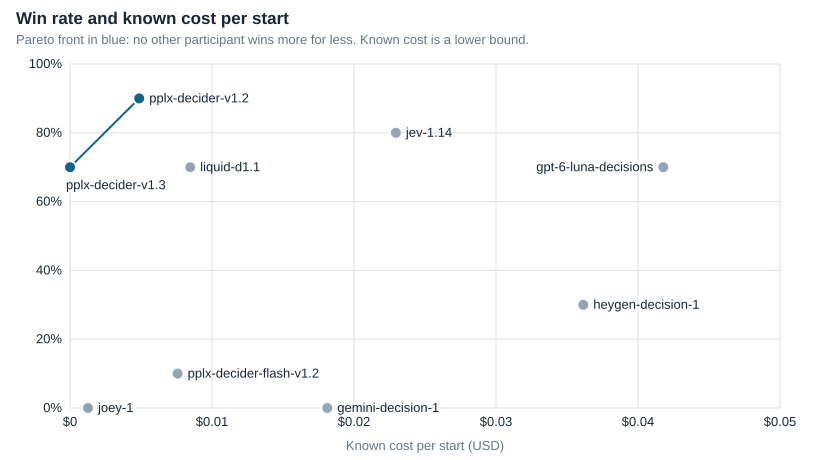
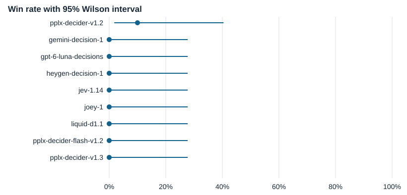
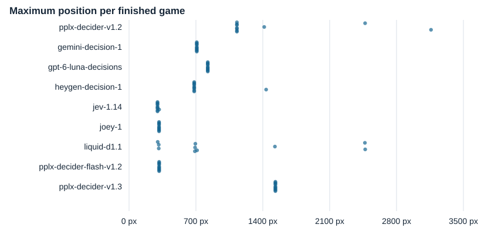
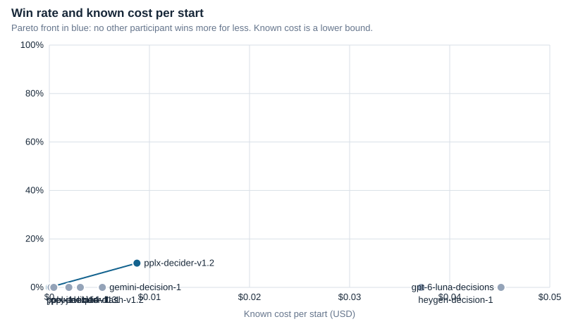

# SuperMAIrio · Benchmark v1

Edition started 2026-11-13T16:28:34+00:00 · `SuperMarioBros-1-1-v0` · commit `5e07abea744bdcd0111b3b1b6718e27e6d019014`.

[Attempts CSV](attempts.csv) · [Logs and inputs for replay](edition.zip)

Position is the maximum horizontal coordinate reached. Interruptions include provider failures and local stops. The Wilson interval assumes independent games. Latency per decision includes the network and, in the turn-based track, both questions. Real-time sessions ran one at a time; turn-based sessions ran 4 at a time. Cost coverage counts recorded responses; failed or cancelled requests may add unreported costs.

## Real-time track (60 FPS)

| Rank | Participant | Model | Endpoint | Wins | 95% CI | Interruptions (provider) | Median winning frames | Fastest win (frames) | Latency median/p95 s | Known $/start | Cost coverage | Median FPS | Late choices |
| ---: | --- | --- | --- | ---: | --- | --- | ---: | ---: | --- | ---: | ---: | ---: | ---: |
| 1 | pplx-decider-v1.2 | perplexity/pplx-decider-v1.2 | https://openrouter.ai/api/alpha/decisions | 9/10 (90%) | 60%–98% | 0/10 (0) | 1547 | 1310 | 0.349 / 0.420 | 0.00487 | 553/1105 | 60.04 | 10/545 |
| 2 | jev-1.14 | typesafe/jev-1.14 | https://openrouter.ai/api/alpha/decisions | 8/10 (80%) | 49%–94% | 0/10 (0) | 2012 | 1796 | 0.217 / 0.267 | 0.02295 | 1080/2165 | 60.02 | 3/1070 |
| 3 | gpt-6-luna-decisions | openai/gpt-6-luna-decisions | https://openrouter.ai/api/alpha/decisions | 7/10 (70%) | 40%–89% | 3/13 (3) | 2555 | 2353 | 0.204 / 0.342 | 0.04178 | 1275/2548 | 60.02 | 15/1267 |
| 3 | liquid-d1.1 | liquid/d1.1 | https://openrouter.ai/api/alpha/decisions | 7/10 (70%) | 40%–89% | 0/10 (0) | 2338 | 1751 | 0.289 / 0.475 | 0.00847 | 963/1925 | 60.02 | 18/953 |
| 3 | pplx-decider-v1.3 | perplexity/pplx-decider-v1.3:free | https://openrouter.ai/api/alpha/decisions | 7/10 (70%) | 40%–89% | 0/10 (0) | 2001 | 1492 | 0.438 / 0.616 | 0.00000 | 465/925 | 60.03 | 11/458 |
| 6 | heygen-decision-1 | heygen/heygen-decision-1 | https://openrouter.ai/api/alpha/decisions | 3/10 (30%) | 11%–60% | 0/10 (0) | 2534 | 1800 | 0.633 / 1.545 | 0.03615 | 193/384 | 60.06 | 18/188 |
| 7 | pplx-decider-flash-v1.2 | perplexity/pplx-decider-flash-v1.2 | https://openrouter.ai/api/alpha/decisions | 1/10 (10%) | 2%–40% | 1/11 (1) | 2648 | 2648 | 0.207 / 0.241 | 0.00758 | 1876/3749 | 60.01 | 13/1872 |
| 8 | gemini-decision-1 | google/gemini-decision-1 | https://openrouter.ai/api/alpha/decisions | 0/10 (0%) | 0%–28% | 0/10 (0) | — | — | 0.228 / 0.373 | 0.01812 | 401/802 | 60.07 | 1/391 |
| 8 | joey-1 | baseten/joey-1 | https://openrouter.ai/api/alpha/decisions | 0/10 (0%) | 0%–28% | 0/10 (0) | — | — | 0.235 / 0.255 | 0.00127 | 297/591 | 60.10 | 1/290 |

## Turn-based track

| Rank | Participant | Model | Endpoint | Wins | 95% CI | Interruptions (provider) | Median winning frames | Fastest win (frames) | Latency median/p95 s | Known $/start | Cost coverage | Median FPS | Late choices |
| ---: | --- | --- | --- | ---: | --- | --- | ---: | ---: | --- | ---: | ---: | ---: | ---: |
| 1 | pplx-decider-v1.2 | perplexity/pplx-decider-v1.2 | https://openrouter.ai/api/alpha/decisions | 1/10 (10%) | 2%–40% | 0/10 (0) | 2386 | 2386 | 0.678 / 1.287 | 0.00875 | 1298/1298 | — | — |
| 2 | gemini-decision-1 | google/gemini-decision-1 | https://openrouter.ai/api/alpha/decisions | 0/10 (0%) | 0%–28% | 0/10 (0) | — | — | 0.509 / 1.236 | 0.00530 | 150/150 | — | — |
| 2 | gpt-6-luna-decisions | openai/gpt-6-luna-decisions | https://openrouter.ai/api/alpha/decisions | 0/10 (0%) | 0%–28% | 0/10 (0) | — | — | 0.445 / 0.779 | 0.04513 | 1360/1360 | — | — |
| 2 | heygen-decision-1 | heygen/heygen-decision-1 | https://openrouter.ai/api/alpha/decisions | 0/10 (0%) | 0%–28% | 0/10 (0) | — | — | 0.846 / 1.750 | 0.03714 | 265/265 | — | — |
| 2 | jev-1.14 | typesafe/jev-1.14 | https://openrouter.ai/api/alpha/decisions | 0/10 (0%) | 0%–28% | 0/10 (0) | — | — | 0.466 / 0.612 | 0.00195 | 128/128 | — | — |
| 2 | joey-1 | baseten/joey-1 | https://openrouter.ai/api/alpha/decisions | 0/10 (0%) | 0%–28% | 0/10 (0) | — | — | 0.480 / 0.578 | 0.00017 | 50/50 | — | — |
| 2 | liquid-d1.1 | liquid/d1.1 | https://openrouter.ai/api/alpha/decisions | 0/10 (0%) | 0%–28% | 0/10 (0) | — | — | 0.680 / 1.145 | 0.00310 | 467/467 | — | — |
| 2 | pplx-decider-flash-v1.2 | perplexity/pplx-decider-flash-v1.2 | https://openrouter.ai/api/alpha/decisions | 0/10 (0%) | 0%–28% | 0/10 (0) | — | — | 0.403 / 0.656 | 0.00044 | 140/140 | — | — |
| 2 | pplx-decider-v1.3 | perplexity/pplx-decider-v1.3:free | https://openrouter.ai/api/alpha/decisions | 0/10 (0%) | 0%–28% | 0/10 (0) | — | — | 0.785 / 1.568 | 0.00000 | 1020/1020 | — | — |

